<picture>
  <source media="(prefers-color-scheme: dark)" srcset="assets/banner-dark.svg">
  
</picture>

### [Read the full story at personal-website-khili.vercel.app](https://personal-website-khili.vercel.app)

<picture>
  <source media="(prefers-color-scheme: dark)" srcset="assets/h-abstract-dark.svg">
  
</picture>

I'm a data analyst based in Kuala Lumpur, Malaysia, with a BSc in Mathematics and Statistics from the University of Leeds. I care about the statistics behind a result as much as the result itself. I also write the occasional essay. My website has the full story, my work, and my writing, so start there.

<picture>
  <source media="(prefers-color-scheme: dark)" srcset="assets/h-keywords-dark.svg">
  
</picture>

**Roles:** Data Scientist, Data Analyst, Data Engineer (open to these roles in Malaysia)  
**Interests:** research, statistics  
**Currently:** working as a data analyst in Kuala Lumpur, Malaysia

<picture>
  <source media="(prefers-color-scheme: dark)" srcset="assets/h-selected-work-dark.svg">
  
</picture>

1. **[VolleyRo](https://github.com/Durianlychee/VolleyRo)** - volleyball 5-1 rotation web app ([live demo](https://durianlychee.github.io/VolleyRo/))
2. **[datafest2026-svh-disengagement](https://github.com/Durianlychee/datafest2026-svh-disengagement)** - ASA DataFest 2026: survival analysis and spatial modelling of patient disengagement
3. **[rocket-launch-killy](https://github.com/Durianlychee/rocket-launch-killy)** - SpaceX landing prediction, IBM Data Science project
4. **[sales-dashboard-tail-winds](https://github.com/Durianlychee/sales-dashboard-tail-winds)** - Power BI sales and profitability dashboard
5. **[CampusConnect](https://devpost.com/software/campusconnect-hyt39e)** - LeedsHack 2026, won MLH Best Use of ElevenLabs

<picture>
  <source media="(prefers-color-scheme: dark)" srcset="assets/h-toolbox-dark.svg">
  
</picture>

<picture>
  <source media="(prefers-color-scheme: dark)" srcset="assets/toolbox-dark.svg">
  
</picture>

<picture>
  <source media="(prefers-color-scheme: dark)" srcset="assets/h-contact-dark.svg">
  
</picture>

- [Contact page](https://personal-website-khili.vercel.app/contact) on my website
- [LinkedIn](https://www.linkedin.com/in/addakhili-ibrahim)

<picture>
  <source media="(prefers-color-scheme: dark)" srcset="assets/rule-dark.svg">
  
</picture>

### [Visit my website: personal-website-khili.vercel.app](https://personal-website-khili.vercel.app)

